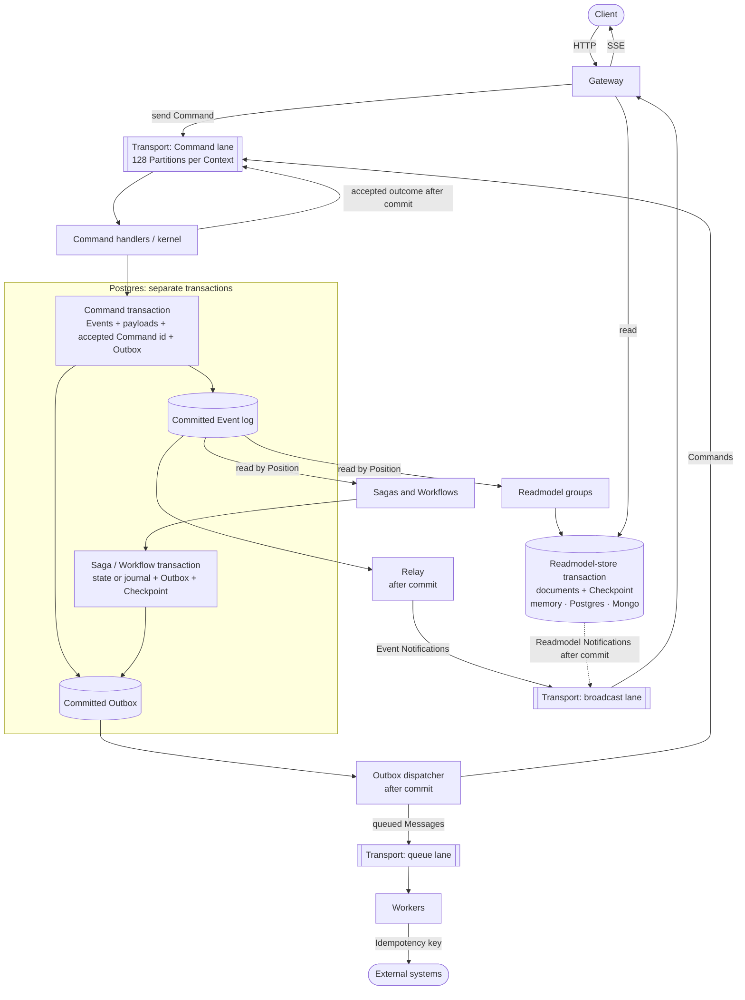
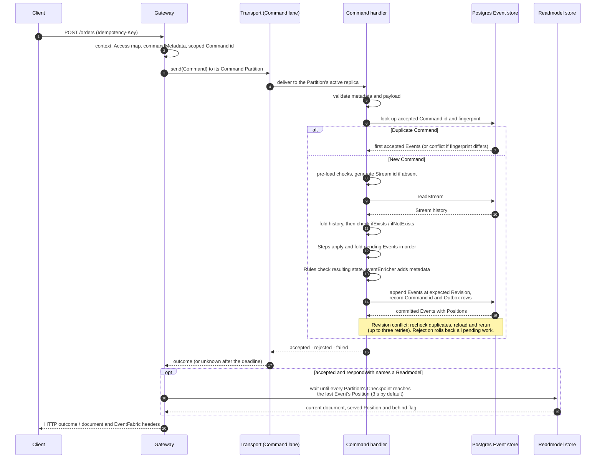
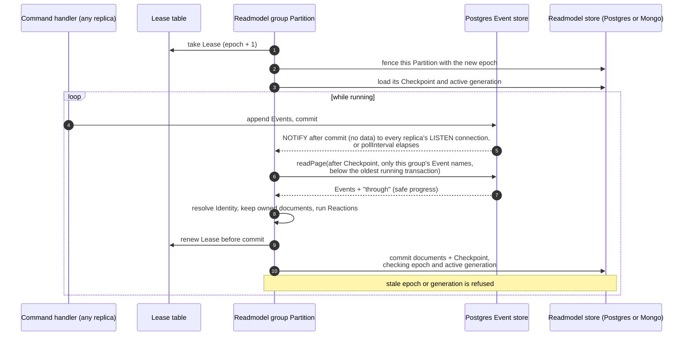
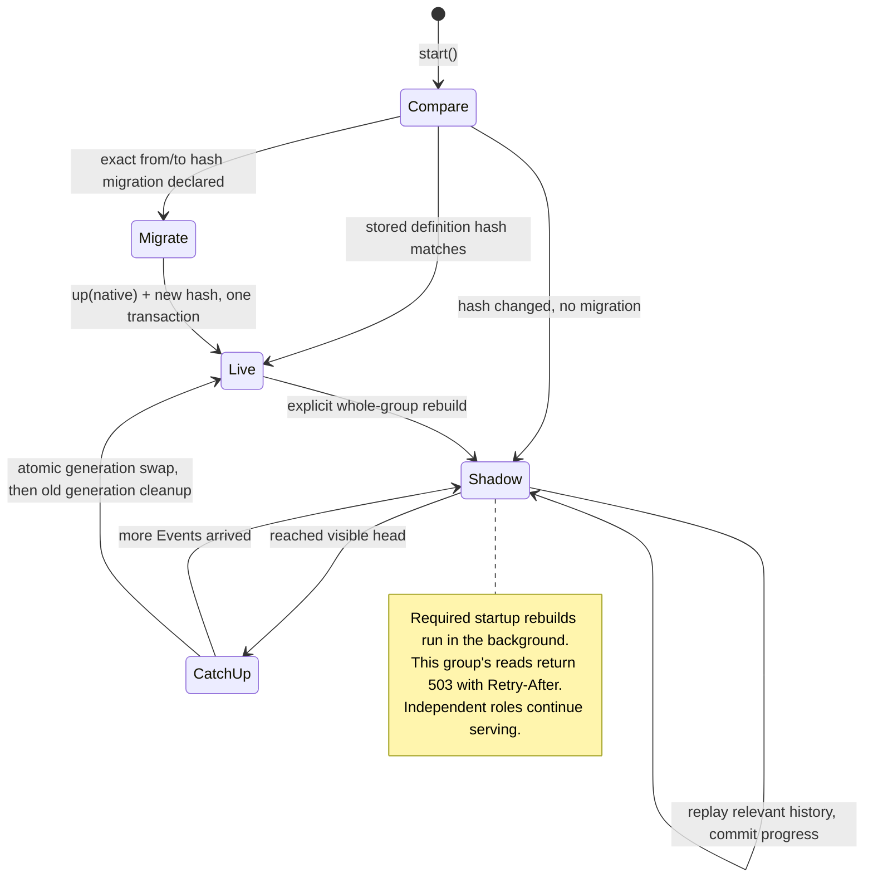
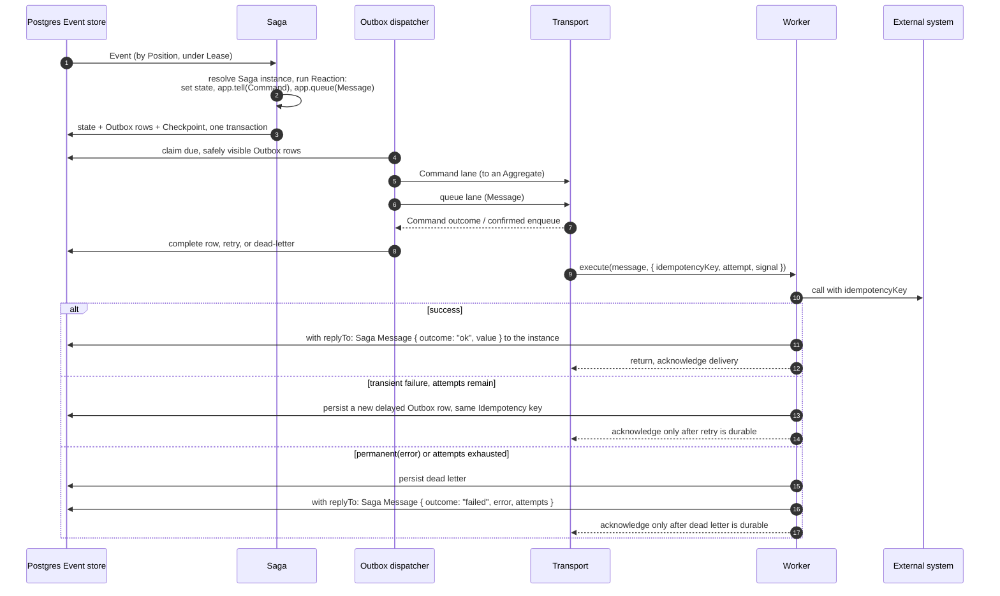
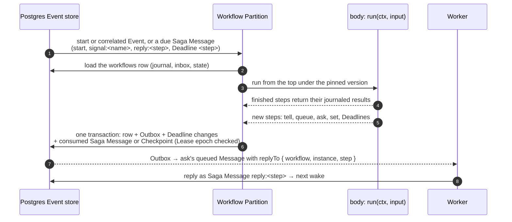
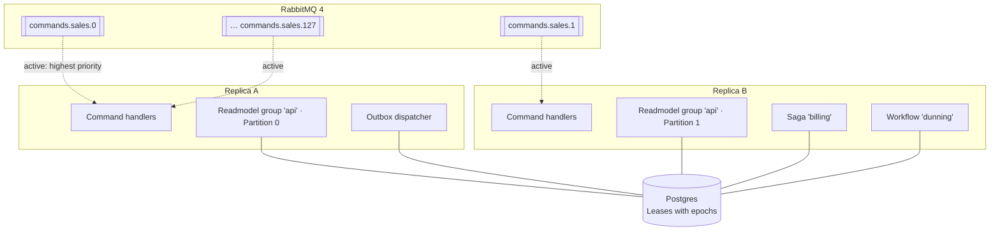

# How EventFabric works

EventFabric runs event-sourced CQRS Applications. An Application declares Aggregates, Readmodels, Sagas, Workflows, Workers and Gateways. EventFabric stores the Events, routes Commands, keeps Readmodels, Sagas and Workflows up to date, and delivers effects. This page shows how the parts fit together and how a request flows through them. Terms follow [GLOSSARY.md](../GLOSSARY.md); the decisions behind each part are in [docs/adr](adr/). To see how this differs from the framework EventFabric replaces, read [comparison-with-oblak.md](comparison-with-oblak.md).

## Building blocks

| Part | What the Application writes | What EventFabric does with it |
| --- | --- | --- |
| **Aggregate** | `initialState`, Commands as ordered Steps and Rules, Event handlers that fold state | Loads the Stream, runs the Command, appends its Events with an expected Revision |
| **Readmodel** | Schema, Identity, Reactions, indexes | Applies Events to documents in a Readmodel store, commits documents and Checkpoint together |
| **Saga** | Identity, Reactions, state | Applies Events to Saga instances, records the Commands and Messages they send in the Outbox |
| **Workflow** | One `async run(ctx, input)` per instance, its start Event or id, correlated Events, Signals, a `set` view | Runs the body once per wake against its journal (Events, Signals, Deadlines, Worker replies), commits journal, state and Outbox together; answers `queryWorkflow` from the store |
| **Worker** | `handles`, `execute(message, ctx)` | Delivers queued Messages at least once, with retries, an Idempotency key and dead letters |
| **Gateway** | Express routes, Access map, `context`, `commandMetadata` | Sends Commands, reads Readmodels, streams Notifications over SSE |
| **Services** | Provider clients, pools, helpers | Supplies them through `getServices()` or `ctx.services`; borrows `services`, or runs registered cleanup for resources built in `setupServices` |
| **Task** | `run(ctx, args)` | Initializes Services and runs a one-off CLI script; starts no consumers or Gateways, so Commands need a running Application replica |

Object definitions, TypeScript `aggregate()` declarations and optional Decorated classes share the same runtime; Handles provide typed names and Command builders. Readmodel Reactions may receive only deterministic **Readmodel helpers** through `readmodelServices`; otherwise they retain access to Services. Access to a client does not make it safe to call during a Reaction.

Infrastructure behind them:

- **Postgres Event store and coordination**: the immutable Event log (`events` and `event_payloads`), accepted Command ids, Saga state, pending Saga Messages and Deadlines (`saga_messages`), Workflow instances (`workflows`), the Outbox, dead letters and Leases. Saga, Workflow and relay Checkpoints live here; Readmodel Checkpoints live with their documents in their Readmodel store.
- **Transport**: in-memory or RabbitMQ. It carries Commands (request and reply), Notifications and broadcast Messages (at most once) and queued Messages (at least once). It never carries Events as the source of truth (ADR-0008).
- **Readmodel stores**: in-memory, relational Postgres or Mongo, chosen per Readmodel group (ADR-0009).

## System overview



These are **three separate transaction boundaries**, not one transaction spanning the whole request. A Command commits its Events, accepted id and Outbox entries together. A Saga later commits its state, Outbox entries and Checkpoint together; a Workflow commits its instance row (journal, state, status) the same way. A Readmodel group commits its documents and Checkpoint in its own store, including when that store is Mongo. A Command can therefore be accepted before either consumer has caught up.

Durable outgoing work is recorded before it is sent. A crash after commit leaves the Outbox available for delivery; a crash after sending but before recording completion can send it again. Notifications are published after commit without durable delivery to each subscriber, so clients must tolerate missing them.

## A Command, end to end



- **Partitioning.** `FNV-1a(Context.Aggregate.id) % 128` selects the lane. A creation Command without a Stream id uses its Command id instead. Commands in one lane run serially in normal operation; after a crash or ownership change, the expected Revision prevents two attempts appending against the same state. There is no cross-Stream order.
- **Duplicates.** A unique accepted-id record makes acceptance at most once, even if concurrent duplicates both execute before one wins the commit. The fingerprint covers the name, Stream as sent and validated payload; reusing an id for different content rejects with `conflict`. Accepted ids never expire; rejected and failed Commands leave no record. This also covers accepted Commands that emit no Events. [ADR-0014](adr/0014-duplicate-commands-detected-by-command-id-in-the-event-store.md).
- **HTTP idempotency is opt-in.** Configure `idempotencyScope(ctx)` so the Gateway derives an id from the caller's scope and `Idempotency-Key`. Without that function the header is ignored with a warning. A duplicate returns the first accepted Events, but `respondWith` reads the current document rather than caching the first HTTP body.
- **Rejection and retry.** Returning `false` does not reject: Preconditions, Steps and Rules must throw. Infrastructure failures produce `failed`. Steps can run again on a Revision conflict, so external writes belong in Workers. Event folds use the recorded `timestamp` and must be deterministic.

The default Command helper responds as follows:

| Outcome | HTTP response |
| --- | --- |
| Accepted, no `respondWith` | 200, or 201 with `creates: true`; accepted outcome and Events |
| Accepted, requested document exists | 200/201 with the document; also `EventFabric-Behind` if the wait expired or the group is halted |
| Accepted, document absent or group awaiting a required rebuild | 202 with the accepted outcome; `EventFabric-Behind` is set when a read reports lag, not automatically for every 202 |
| Rejected / failed / unknown | Rejection-specific 4xx / 500 / 504 respectively; `unknown` means the sender cannot tell whether the Command committed |

`EventFabric-Command-Id` identifies the Command; `EventFabric-Position` carries its last Event's Position when it emitted Events. Later reads can send that opaque token as `EventFabric-Min-Position`. A timed-out Command may still commit: retry with the same id. Read-your-writes covers the named group's progress, not completion of downstream Sagas or Workers.

## Readmodels: from Event to document



- **What wakes a Partition.** No broker delivers Events to Readmodels or Sagas; oblak delivered them over its bus, EventFabric does not use RabbitMQ for them. Each replica holds one Postgres connection on `LISTEN`. Every transaction that appends Events sends a `pg_notify` after it commits, and every replica then wakes its idle Consumer-group loops, merging wakes that arrive within 10 ms of each other. The notification carries no data: each woken Partition reads the log from its own Checkpoint. So a missed notification loses nothing, and idle loops also poll every `pollInterval` (1000 ms by default). A Partition that found work reads its next page at once. The Readmodel store takes no part in this: whether it is Postgres or Mongo, it only receives the Partition's reads and commits, and never sees an Event or a notification.
- **Position.** The pair `(transactionId, sequence)` orders Events across Streams. Readers admit only transaction ids below `pg_snapshot_xmin(pg_current_snapshot())`, so a later commit cannot appear behind an advanced Checkpoint. This is transaction-id order, not wall-clock or commit-time order. Within one Stream it is also Revision order. Long or idle transactions on the same Postgres cluster can hold back consumers and the Outbox. [ADR-0004](adr/0004-position-is-transaction-id-plus-sequence.md).
- **What a load costs.** The kernel folds the Stream's Events as the store returned them: every read hands over fresh Events, so the kernel freezes their data in place instead of copying each one first. A Reaction's `state.set` copies only the frozen values it keeps. `loadAggregate`, called with a history its caller holds, still copies.
- **What an append costs.** The kernel reads the Stream while it checks for a Duplicate Command, then appends in one transaction of three statements: `BEGIN` with its timeouts, one statement that checks the Revision, records the Command id and inserts every Event and payload, and `COMMIT`. Outbox rows add two statements however many there are. An append that changes a Schedule also takes the Stream lock and reads the Schedule rows.
- **Filtered progress.** `readPage` loads only Event types named by the group's or Saga's Reactions, while `through` proves progress across excluded Events. An empty page can advance the Checkpoint. A partial fold cannot advance past any selected Event it has not finished. Live batches contain at most 100 selected Events, with a 50 ms fold cutoff; rebuild batches 5,000, with a 2 s cutoff. A page also says whether it reached the end of the visible log; a due Saga Message waits for a page that did ([ADR-0020](adr/0020-saga-messages-are-system-events-outside-the-event-log.md)).
- **What a tick costs.** A Partition keeps its Checkpoint in memory while it holds the Lease: it reads it from the store once, after acquiring the Lease, and then knows every value it commits. Status updates answer from the same memory. It reads operator skips only while it retries a failing Event or on its first page under a new Lease, and it leaves Lease renewal to the renewal timer: the Readmodel store refuses a commit under an older epoch, and a skip or a new owner raises the epoch before anything else. So an idle Readmodel tick is one log read, and a live batch is one log read and one commit. Each Reaction and Identity declaration is parsed once, and every Reaction that sees a read Event gets the same frozen view of it.
- **Atomic Checkpoint.** Documents and Checkpoint commit in the same store; a Mongo store therefore needs replica-set transactions. After a crash, an uncommitted batch runs again; a committed batch resumes after its Checkpoint. The handlers may execute more than once, but their stored changes are not applied twice to the same generation. Documents need no per-document Position.
- **Failure.** A failing Reaction rolls back its batch and retries. After five attempts its Partition reports `halted` while continuing retries with backoff. `consumers retry` wakes it; an explicit `consumers skip` records the operator's decision and advances past the exact halted Event. A rebuild ignores those skips and attempts the full history again.
- **What a read costs.** A query reads the group's status only when it reports one or waits: `find`, `findOne`, `count` and `stream` without `minPosition` go straight to the store, and a Gateway `GET` of one document reads the status once. Concurrent readers of one group share a status read started in the last 10 ms. A store read is one read-only transaction that looks up the group record and then the rows; the active generation's record comes from memory until a swap or a registration changes the group record. When the store's own predicate selects exactly the matches, its rows are returned without a second match in Node, and a Postgres or Mongo store's rows without a copy.
- **Read-your-writes and dependencies.** `minPosition` and `respondWith` wait for every Partition of the group. Cross-group reads must appear in `reads`; processing waits for those groups to reach the Event's Position. Their documents can already be newer than that Position: this is not a historical snapshot.

### Schema changes and rebuilds



Startup compares a stored definition hash, including resolved schemas and indexes but excluding function bodies. An exact hash migration runs during initialization; otherwise a required rebuild runs in the background after startup, in dependency order. One replica rebuilds each group; others wait for its generation to change. Commands, Workers, the Outbox, Gateways and independent groups keep running. A Readmodel group or Saga that declares the rebuilding group in `reads` waits for its swap.

During a required rebuild, the affected group's reads, waits and subscriptions throw `ReadmodelRebuildingError` (HTTP 503 with `Retry-After`). A Command using it for `respondWith` still commits and returns 202. `health().rebuilding` lists these groups; rebuilding alone does not make the Application unready. An explicit rebuild of an otherwise compatible group keeps its active generation available until the replacement is ready.

Each shadow batch persists its progress. Interrupted startup rebuilds resume; failed attempts are logged and retried. [Stopping and resuming](readmodel-rebuilds.md#9-stopping-and-resuming) covers what a killed rebuild leaves behind and how to resume it. A reconstruction fingerprint covers the group's declarations, resolved schemas, declared Event schemas/Upcasters and dependencies, and rejects resumption or swap under incompatible code. Bump `rebuildVersion` when helper behavior, captured configuration or externally configured Upcasters change. **Reaction-code changes and `rebuildVersion` do not automatically rebuild active documents**: request a whole-group rebuild when historical results must change.

Automatic publication catches up and swaps the complete group atomically, then removes the old generation. `rebuild <group> --swap manual` prepares a generation; `rebuild --swap <group>` catches it up and publishes it later. Keep the reconstruction definition consistent across replicas. Cross-group reads can make a rebuild differ from its original live run, so record required historical values in Events. Sagas are never rebuilt, and document/id/Position-range rebuilds are not provided. [Readmodel rebuilds](readmodel-rebuilds.md) follows a rebuild end to end: reading, folding, writing, pipelining, fold workers and the swap.

## Sagas, the Outbox and Workers



- **Replies.** A Message a Saga queued with `replyTo` carries `replyTo: { saga, instance, name }`, so the Saga hears how it ended: after a successful `execute`, and after the dead letter, which otherwise only an operator sees. The reply is a Saga Message (ADR-0020) whose id is derived from the Idempotency key and the outcome, so a re-run after a crash finds the pending reply instead of adding one; the handler still sees a reply at least once. A reply that cannot be recorded fails a successful attempt (it retries) and, after a dead letter, is logged; replaying that dead letter replies again. A Workflow's `ask` uses the same envelope with `replyTo: { workflow, instance, step, run }`; its reply is the Saga Message `reply:<step>@<run>`.

- Saga Reactions record intent; external calls belong in Workers. Readmodel Reactions cannot send Commands or queue Messages. Saga `destroy()` removes its state without deleting recorded Outbox work. [ADR-0011](adr/0011-effects-leave-through-the-outbox.md).
- A Worker has five attempts by default, exponential backoff with jitter, and a 60 s default timeout. `throw permanent(error)` dead-letters immediately. Honor `signal`: a timeout cannot undo an external call. A crash between that call and the broker acknowledgement can repeat it; provider support for the Idempotency key is what prevents duplicate effects.
- The key includes the source, Saga instance (when applicable), causing Event or Command id, and effect suffix. It stays stable across retries, dead-letter replay, batch sizes and Partition layouts.
- Outbox delivery has its own retry policy: failed deliveries dead-letter after five failures; an `unknown` Command outcome keeps retrying with the same Command id. A Rejection dead-letters immediately as `outbox-rejected` and unblocks later Commands to the Stream. If the business must react to refusal, the Aggregate must record an Event; a Rejection alone does not notify a Saga.
- `notBefore` delays work; `replaceKey` replaces pending work only until dispatcher admission. It cannot cancel an already admitted delivery. Recurring scheduling belongs outside EventFabric.
- **What a delivery costs.** The dispatcher admits every row of one poll in one transaction: `BEGIN`, the Lease fence, one `UPDATE` that applies the ordering rule below to all of them, and `COMMIT`. Admitting a scheduled Command also takes its Stream's lock, in one order across the batch. Each admitted row is then sent on its own, and completions that arrive while one is written are deleted together in the next statement.
- Commands to one target Stream leave in recording-transaction-id order, then recorded order within that transaction. A due or retrying earlier Command holds back later ones; a delayed Command not yet due does not. Different Streams and queued Messages proceed independently. One Saga instance therefore preserves its Event order to a target Stream; separate instances have no shared business order.
- **Where a new group starts.** A Saga or Workflow group is new while it has no `layout:<group>` row and no Partition has a Checkpoint: first deployed, or retired and deployed again. Its `from` decides where it starts: `"now"` (the default) after the log's head when the replica that starts it started, `"beginning"` before the first Event, a `Date` before the first Event recorded at or after it (Positions follow transaction ids, so an Event stamped just before the date but committed after that one is included too), or `{ position }` after a token `EventFabric-Position` returned. Partition 0's Lease holder takes every Partition's Lease, resolves `from` once and, in one transaction, writes the Position as every Partition's Checkpoint and records `from` and the Partition count in the `layout:<group>` row, so every replica continues from the same place. Restarts, Lease handovers and `partitions` changes find the row and keep the Checkpoints; a different `from` then only logs a warning. Replaying history means retiring the group and deploying it again with `from: "beginning"`. `from` limits only what the group reads from the log: a Workflow's `startWorkflow` starts, Signals and `ask` replies are Saga Messages and arrive whatever it says. Readmodel groups have no `from`; they always fold the whole log.

### Workflows

A **Workflow** is the other way to write a long-running process ([ADR-0021](adr/0021-workflows-are-replayed-functions-beside-sagas.md)): one `async` function per instance that waits, where a Saga is Reactions over hand-kept state. It runs as the consumer kind `workflow:<name>` beside Sagas, on the same Partitions (`fnv1a(id) % N`), Leases and Checkpoints, and needs no other service.



- **Wakes.** Starting and correlated Events come from the log like a Saga's; every other wake is a Saga Message to the instance: `start` (from `startWorkflow`), `signal:<name>` (from `sendSignal(id, signal)`, the Signal naming its Workflow), the `ask` reply `reply:<step>@<run>`, and a `sleep` or `waitFor` Deadline named after its step (due after a duration or at an absolute `at`, as a Saga's `deadline(name, at)`). Delivery and ordering follow ADR-0020. One wake runs the body once.
- **Steps and the journal.** Every `ctx` call is a step named by its name and occurrence (`event:billing.invoice.settled#1`, `ask:send-reminder#0`); steps that send or read also record their arguments. On each wake the body runs from the top and finished steps return what they recorded, so a restart or a Lease handover repeats no Command, Message or reply. Arguments are compared as JSON with sorted keys, since Postgres JSONB does not keep property order. The body gets copies of its input and of each step's value, so changing them never changes the journal. `set` views and results are stored as JSON (a `Date` becomes its ISO text); one that cannot be JSON fails the instance. Two steps of the same name in concurrent branches (`Promise.all`) are told apart only by the order they are reached; give them distinct names (`sleep("a", …)`, `sleep("b", …)`) so a reordering cannot swap their results.
- **Determinism.** The body awaits only `ctx` calls and takes time, randomness and ids from `ctx.now()`, `ctx.random()` and `ctx.uuid()`; the `determinism` lint rule covers `run`. `ctx.read` journals the document as JSON and revives its `DateTime()` fields from the Readmodel's schema, so it is the same value on the first run and every replay.
- **Outcomes.** A body that returns ends `completed` with its result; a body exception ends it `failed`; `ctx.cancel()` or `workflows cancel` end it `cancelled`. Runtime and store errors retry as a Saga Message's do. A run that reaches a new step while a finished one was never reached, or replays a step with other arguments, has **drifted**: the row is parked `drifted`, its Saga Messages dead-lettered (`workflow-drifted: <reason>`) and its Events kept in its inbox; the Partition runs on. A Signal to a missing or finished instance dead-letters as `workflow-missing`. A start of a finished id without `reuse` is refused: `startWorkflow` throws a `Rejection` coded `workflow-finished` (a Gateway's 422), and a start recorded by a Saga or sent by `ctx.start` dead-letters as `workflow-finished`, or as `workflow-missing` when it carries a Signal.
- **Runs.** A new instance, each `restart` and each reused id begin a new run with its own random `run` id. A queued Message's Idempotency key and an `ask`'s reply name it, so two restarts in one wake never share a key, and a Worker's reply to an earlier run (one cancelled while it waited, then reused) is dropped. Instances from before migration 11 have no run and keep the old keys.
- **Versions.** An instance pins the `version` it started under. Ship a body change that moves, renames or removes steps as a new version, registered as `{ versions: [v1, v2] }` until the old instances finish; new instances and a `restart`'s fresh journal take the highest. Correlated Events route by every registered version's `correlate` (an instance takes those its pinned version routes), a Signal is checked against the pinned version's declaration, and the Partition waits on every version's `reads`; `ctx.read` checks the reads of the version whose body runs, so a `restart` into a newer version may read what it newly declares. The generated Register lists every registered version's Signals, so old instances can still be sent theirs. `workflows resume` runs a drifted instance again once matching code is deployed.
- **Retiring.** `consumers retire workflow:<name>` removes a Workflow no deployment declares, as it removes a Saga: its Checkpoints, `layout:` row, pending Saga Messages and Deadlines, and every `workflows` row of the group, running or finished. A Workflow added back later is a new group and starts where its `from` says (below).
- **Queries.** `queryWorkflow` reads status, the `set` view and the result from the row; nothing runs the body to answer.

The Postgres table, created by migrations 8, 9 and 11:

| Column | Holds |
| --- | --- |
| `group_name`, `id` | Primary key: `workflow:<name>` and the instance id |
| `version` | The definition version the instance pinned |
| `status` | `running`, `completed`, `failed`, `cancelled` or `drifted` |
| `input` | The start input (the start Event for an Event-started Workflow) |
| `journal` | Steps by `name#n`: `done` with value, `pending` with its Deadline, or `cancelled`; emptied when the instance finishes |
| `inbox` | Signals and correlated Events not yet read, oldest first |
| `state`, `result`, `error` | The `set` view, the return value, the failure or drift reason; JSON `null` is a value, SQL `NULL` none |
| `cancel_requested` | A cancel waiting for the body's next `ctx` await |
| `started_at`, `finished_at` | Lifecycle times; `workflows purge --finished-before` deletes by the second |
| `run` | The current run, which a Worker's reply must name; `NULL` for instances from before migration 11 |

Indexes: `workflows_status (status, group_name, id)` for `workflows list --status`, and the partial `workflows_finished (finished_at)` for purge. A finished row stays until purged.


`dead-letters replay <id>` resets attempts and requeues the work with its original Command id or Message Idempotency key. Dead letters preserve failed work for operator action; at-least-once delivery is not a promise that an external operation will eventually succeed.

## Live updates

The relay copies visible committed Events onto the broadcast lane as Notifications; Readmodel groups publish document-change Notifications after their own commits. Gateway Readmodel subscriptions apply the Access map's filters and stream over SSE. Authorization for a client-facing Event feed belongs to the Application.

The broadcast lane is at most once per publication, with no subscriber catch-up. Relay recovery can republish; subscriptions suppress repeats using Position (per document for partitioned Readmodels). The relay can also skip stale backlog beyond `relayMaxLag` (60 s by default). A subscriber that falls behind loses its oldest Notifications at the broker: its queue holds at most `broadcastMaxLength` messages. Clients re-read on reconnect; neither Notifications nor SSE are a durable Event-consumption interface.

## Horizontal scaling



| What scales | How it is shared across replicas | Ordering kept |
| --- | --- | --- |
| Command handlers | 128 Partitions per Context, each an interactive and a bulk quorum queue (the Command lanes, handled at once), single active consumer; each replica subscribes to both with the Partition's rendezvous-hash consumer priority, so RabbitMQ spreads the queues and fails them over without waiting for a Lease (ADR-0015) | Per Stream and lane; one Stream's Commands run one at a time |
| Readmodel groups, Sagas, Workflows | One Partition by default; one Lease per Partition, distributed by capped rendezvous score; epochs fence stale commits | Global Position order within each Partition |
| A hot group | `partitions: N`: every Partition advances through the global history, resolves Identities, and applies only owned documents (`model/id`) or Saga and Workflow instances (`id`); Readmodels load only relevant Event types (ADR-0016) | Per document / Saga instance; no atomic visibility across Partitions |
| Workers | Replicas compete on the same Worker's queue; `concurrency` controls simultaneous attempts per replica | No completion order |
| Outbox, relay | One leased owner each | Per target Stream (Outbox) |
| Roles | `event-fabric run --only kind:name`; kinds: `commands`, `readmodels`, `saga`, `workflow`, `worker`, `gateway`, `outbox`, `relay` | Same guarantees, provided all required roles run somewhere |

**Which replica runs which Partition.** Each replica keeps an `instance:` row in the Lease table that lists the Consumer-group Partitions it runs (`--only` narrows the list), and renews it with its Leases every 10 s. From the same live rows, every replica computes the same assignment. For each Partition, the replicas that run it are ranked by a rendezvous hash of replica and Partition, and the highest-ranked one still below its fair share (`ceil(Partitions / replicas)`) is preferred. A replica takes a free Lease only if it is preferred, or if no replica has taken that Lease for a whole `leaseDuration`. A holder that is no longer preferred, for example because a replica joined, releases its Lease between ticks, so the Partition never has two active owners. If a replica dies, its Leases expire after `leaseDuration` (30 s by default) and the preferred survivors take them; the new epoch refuses any late commit from the old owner. Replicas therefore share Partitions, not Events: each Partition runs on exactly one replica at a time, and a group with one Partition uses one replica however many run. To spread one group's work, raise its `partitions`.

Command Partitions use broker ownership and expected Revision, not Postgres Leases. Readmodel, Saga and Workflow Partitions use Leases and sink-checked epochs. Increasing `partitions` distributes Reaction work but multiplies Event scanning and Identity resolution; it does not divide the Event log into disjoint slices. A partitioned group's Reactions cannot read that group's own documents, because other Partitions may be at different Positions. Cross-group reads and read-your-writes wait for the lowest Checkpoint.

Changing `partitions` fences all old and new Partitions, drains the old layout to one safe Position, then starts the new layout there. Use one configured count across replicas. This changes ownership without replaying committed effects. Neither replicas nor `partitions` appear in stored names: Readmodel tables and collections are named by group, model and generation, Saga state by group and instance id, and each Partition's Checkpoint and Lease live in a `<group>#<p>` record created as needed. Scaling therefore moves no data and renames nothing; only a rebuild writes a new generation. See [ADR-0016](adr/0016-consumer-groups-partitioned-by-document-and-saga-instance.md).

For example, `--only commands:shop/sales` runs one Context's Command handlers, and `--only readmodels:api --only saga:billing` runs two consumer roles. Gateways that serve many live clients run best as `--only gateway:<name>` replicas of their own, so bulk work never shares their event loop ([README](../README.md#operations)). Selectors choose work in an otherwise complete Application config; they do not start missing dependencies elsewhere. Production replicas share Postgres, the broker and their durable Readmodel stores; the in-memory adapters are for tests and local use.

## Guarantees at a glance

| Path | Delivery | Order | Fence |
| --- | --- | --- | --- |
| Command → Events | Acceptance at most once per id; execution may repeat | Serial lane per Stream; no cross-Stream order | Expected Revision and unique accepted-id record |
| Event → Readmodel | Repeated attempts, one committed application per generation, except explicit audited skips | Position order per document; separate Partitions can expose different progress | Documents + Checkpoint, Lease epoch and generation check in the Readmodel store |
| Event → Saga → Outbox | Repeated attempts, state and outgoing intent committed together, except explicit audited skips | Position order per Saga instance | State + Outbox + epoch-checked Checkpoint in Postgres |
| Event, Signal, Deadline or reply → Workflow → Outbox | Repeated attempts; a step's effects committed once with the journal that records it | Per instance as ADR-0020 orders its wakes | Row + Outbox + Deadline changes + consumed Saga Message or Checkpoint, epoch-checked, in Postgres |
| Outbox → Command | At least once until outcome or dead letter; same Command id on retry | Per target Stream, with the delay exception above | Durable Outbox and Command de-duplication at the destination |
| Outbox → queue → Worker | At least once; retries may end in a dead letter | No Message completion order | Acknowledge after success or durable retry/dead letter |
| Worker → external system | Calls can repeat; no exactly-once guarantee from EventFabric | None | Provider must honor the Idempotency key |
| Notifications | At most once per publication; relay may republish; no replay for disconnected clients | Position carried; no global order across Readmodel Partitions | Subscription cursors suppress repeats; reconnect requires a read |

These durability guarantees require the durable adapters. They do not imply exactly-once handler execution or one transaction across Postgres, a Readmodel store, the broker and an external provider.

## Running it

```sh
event-fabric migrate            # apply versioned framework migrations (startup never does)
event-fabric run                # every role; or --only kind:name per role
event-fabric consumers status   # Checkpoints, lag, Lease owners, halted and undeclared groups
event-fabric rebuild <group>    # shadow generation, then swap
event-fabric dead-letters list  # replay or discard failed Messages
event-fabric workflows list     # Workflow instances; inspect, cancel, resume, purge
event-fabric task ./task.mjs    # one-off script against the running Application
```

`application.health()` reports liveness, readiness and the groups still rebuilding. Tracing and metrics use the OpenTelemetry API (an Application installs the exporter); logging takes a pino-compatible logger, and at `debug` it logs 10 s summaries of each Consumer group's stage timings and lag, the Outbox, Readmodel reads and Postgres pool waits. Monitor halted/waiting consumers, lag, Outbox age and dead letters. Long transactions and undersized connection pools can delay progress even when CPU is available. The [README](../README.md) documents the configuration and operational details.
