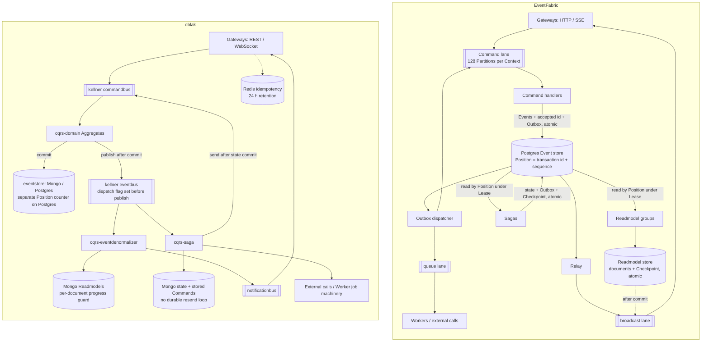

# EventFabric and oblak

EventFabric is the **direct successor of oblak** and its packages: `cqrs-domain` (Aggregates), `cqrs-eventdenormalizer` (Readmodels), `cqrs-saga` (Sagas), `eventstore` (the Event store), `kellner` (the message buses), `zaek`, and `cqrs-swissknife` (the authoring builders).

EventFabric is a clean-room TypeScript rewrite ([ADR-0001](adr/0001-clean-room-rewrite.md)) with two goals:

1. **Keep the interface Applications already write, migrated with codemods.** Preserve the Aggregate definition shape, Preconditions, Steps, Rules and familiar accessors, with mechanical changes where possible. Raw Mongo collections, Mongo-filter Event store queries and runtime internals must migrate to supported interfaces. This is the compatibility goal in [ADR-0002](adr/0002-authoring-interface-compatible-with-codemods.md).
2. **Replace everything underneath so it scales across replicas.** Use a durable Postgres log, a broker-agnostic transport, fenced Consumer groups and a transactional Outbox. EventFabric is designed as a general-purpose package with explicit Application configuration and bounded delivery/ordering guarantees.

This page compares the two. [architecture.md](architecture.md) explains EventFabric on its own terms; [migration.md](migration.md) is the step-by-step migration; [readmodel-rebuilds.md](readmodel-rebuilds.md#compared-with-oblak) compares rebuilds in detail.

**Compatibility is not certified for any particular Application.** A review of the upstream contracts found differences in Aggregate enrichment, Event envelopes, consumer declarations, query results and Gateway factories. The migration keeps the old behavior by default ([ADR-0018](adr/0018-migration-keeps-old-behavior-by-default.md)): the runtime honors old enrichers and Reaction markers, and `migrateSource` emits `event-fabric/compat` helpers where old and new meanings differ. Each Application still needs its own rehearsal on a migration copy. A replacement capability or a retained method name does not establish identical behavior.

## Architecture side by side

The oblak side summarizes the behavior of the inspected oblak stack; backend and Worker implementations vary across upstream and vendored versions.



In oblak the broker carries Events to consumers, with gaps between persistence and publication. In EventFabric, consumers resume directly from the Postgres log. Command Events and outgoing intent share one transaction; Saga state, outgoing intent and progress share another. Readmodel documents and progress share a transaction in their own store. Notifications remain disposable broadcasts, and Workers' external calls remain at least once.

## What stays the same

A simple oblak-style Aggregate definition is accepted unchanged. Here the `definition` object is the shared part; the helper import and explicit `compile` registration are EventFabric's wiring:

```js
import { compile, only } from "event-fabric";

const createSchema = {
  type: "object",
  properties: { title: { type: "string" } },
  required: ["title"],
  additionalProperties: false,
};

// The same definition object in both frameworks
const definition = {
  initialState: {},
  commands: {
    create: [
      only.ifNotExists(),
      only.ifValidatedBy(createSchema),
      (command, aggregate) => aggregate.apply.created(command.payload),
    ],
  },
  events: {
    created: (event, aggregate) => aggregate.set("title", event.payload.title),
  },
};

// oblak: discovered from the Application's folders.
// EventFabric: registered explicitly.
export const order = compile("sales", "order", definition);
```

This example demonstrates the common subset, not every old Aggregate option. An old `eventEnricher` keeps its old timing through `legacyEnricher`: it runs inside each `apply` on the State before that Event and may change the payload or metadata. Written for EventFabric, an enricher runs after Steps and Rules on the final State and adds metadata.

| Surface | Preserved | Migration boundary |
| --- | --- | --- |
| Aggregate shape | `{ initialState, commands, events, idGenerator, rules, eventEnricher }` | Migrated enrichers keep the old per-`apply` timing through `legacyEnricher`; named Rules and `options` are refused; `apply` metadata keeps the old deep merge through `legacyMetadata` |
| Preconditions, Steps and Rules | `only.ifExists`, `only.ifNotExists`, `only.ifValidatedBy`, `only.ifState`, `only.after`; only throwing rejects | Exact overloads, execution phases and error shapes are not all identical |
| Handler argument order | Commands `(command, aggregate, app)`, Events `(event, state)`; named `aggregate.apply.<event>()` and dotted state access | Event envelopes and auxiliary state methods differ |
| Readmodel and Saga shape | Identity plus Reactions `(event, view, app)` with `get` / `set` / `destroy`; `only.if`, `autoCreate` and `shouldHandle` markers | `query` maps, Saga Events without an Identity and grouped keys (into `reactionSets`) are rewritten; Identity strings need hand translation; Readmodels also need schemas |
| Saga Command call shape | `app.getDomain().<context>.<aggregate>(id).<command>(payload, metadata)` | Intent now commits in the Outbox; external calls move to Workers |
| Accessor names | `getDomain()`, `getReadmodels()`, `getServices()` | Aggregate reads gain `.load()`; QueryBuilder chains become `find(...legacyQuery(…))` with the old results |
| Validation capabilities | Ajv, defaults, transforms, async named schemas, custom formats and legacy extra keywords | Ajv 8, schema loading and errors still require corpus checks |
| Services call sites | Application-supplied factories can preserve `getServices().mailer()` | Explicit setup/cleanup replaces recursive discovery; Tasks use `ctx.services` |
| Gateway concepts | REST Command/Readmodel helpers and Access maps | Command descriptors and list routes (`legacyList`, `{ total, data }`) are rewritten; other helper signatures, error bodies and the live protocol must migrate |
| CLI verbs | `run`, `dev`, `task`, `types`, `rebuild` | Configuration, Task exports, generated output and rebuild scope changed |

With a supplied symbol map, `migrateSource()` rewrites generated Event constants to qualified names; `getCrud()` becomes `getServices().crud` when the Application supplies that service. Recognized old forms are rewritten to keep their old behavior; the rest are left for review. **An empty review list means no known pattern was found, not that migration succeeded.** See the [migration guide](migration.md).

## What changed, and why

| Area | oblak | EventFabric | Why |
| --- | --- | --- | --- |
| Language and packaging | CommonJS JavaScript, callback-based, a constructor plus deep imports, mostly untested | TypeScript, ESM only, Node ≥ 24.15, named exports; CommonJS loads it with `require(esm)` (ADR-0010) | One build with no dual-package hazard; a tested core |
| Event store | `eventstore` on Mongo or Postgres; stored Events rewritten by migration Tasks | Postgres only; immutable log, Upcasters on read, payloads in a separate table for later erasure (ADR-0005, 0006) | A Checkpointed reader must never see history change under it |
| Global order | A Position counter incremented in its own autocommit before the insert | Position = writing transaction's id + sequence, read below the oldest running transaction (ADR-0004) | The counter could hand a reader Position 11 before 10 committed, so 10 was skipped forever |
| Event delivery | Events published to the eventbus after commit, marked dispatched before publication; consumers subscribe to topics | Authoritative Event consumers read Postgres by Position; the broker carries Commands, Notifications and Messages (ADR-0007, 0008) | A publication crash can strand committed Events in the old path; durable readers resume from their Checkpoints |
| Readmodel progress | Per-document progress guard in Mongo | Documents and each Partition's Checkpoint commit atomically, fenced by epoch and generation (ADR-0009) | Read-your-writes can wait for every Partition; no double application of committed batches |
| Readmodel stores | Mongo, schemaless | Memory, Mongo (replica set) or relational Postgres, chosen per group, from a declared schema | Postgres tables follow relational conventions; one portable query language plus `native()` |
| Schema changes and rebuilds | Rebuild Tasks per document, model or Position range | Exact schema/index hash migration, or a background whole-group generation rebuild; Reaction changes require an explicit rebuild | Atomic publication of a complete group; independent roles serve while required group reads return 503 and its Command responses return 202 |
| Sagas | Mongo state; stored Commands sent after commit and deleted by `destroy()`; errors logged and Events acknowledged | State + Outbox + Checkpoint in one Postgres transaction; failures keep retrying and report halted after five attempts (ADR-0011) | Outgoing intent survives a crash or state destruction; failures require success or an audited skip |
| External effects | Direct service calls from Sagas could happen before commit | Queued Messages commit as intent; Workers call providers with stable Idempotency keys | Separates external latency from Reactions; duplicate prevention still depends on the provider |
| Delayed work | BullMQ and Redis jobs, Saga timeouts | Outbox rows with `notBefore` and a replace key | One durable mechanism, no Redis |
| Command de-duplication | Redis keys with a 24 h TTL and response cache | Accepted Command id and fingerprint commit atomically and never expire; scoped `Idempotency-Key` opts into this at HTTP (ADR-0014) | A retry cannot accept the id again; differing content conflicts; HTTP renders current Readmodels |
| Transport | `kellner` buses with AMQP/Kafka adapters and broker-specific routing; separate Worker/job mechanisms | Three lanes: Command / broadcast / queue; in-memory and RabbitMQ adapters (ADR-0003, 0008) | One public port with explicit guarantees; no wire or queue compatibility with the old buses |
| Horizontal scaling | Broker consumer groups and queues; no sink-checked epoch for stale Readmodel/Saga writes | RabbitMQ quorum Command queues spread by consumer priority (ADR-0015); Leases and epochs for Event consumers; `partitions: N` (ADR-0016) | Revision and accepted-id checks protect Commands; epoch checks protect stored consumer progress; no global processing order across replicas |
| Gateways and live updates | REST plus a framework WebSocket protocol; request metadata copied implicitly; access rules partly unenforced | Express 5, SSE, explicit `context` → `commandMetadata`; Access maps deny by default on scoped Commands, reads and Readmodel Notifications | Application rules explicitly control access; client Event-feed authorization remains Application-owned |
| Typing | Generated runtime constants file | Typed Handles from TypeBox schemas (ADR-0013), a generated type Register for JavaScript (ADR-0012), optional Axon-style decorators (ADR-0017) | Typos and wrong payloads fail at compile time |
| Services, Tasks and plugins | Recursive loading, service `init` / `close`, load-phase hooks, runtime access | Typed `services` or `setupServices` with an `AsyncDisposableStack`; optional Readmodel helpers; Tasks run setup without plugins; `start`, `gateway`, `shutdown` hooks | Explicit ownership and cleanup; deterministic helpers can replace mutable service access in Readmodel Reactions |
| Operations | Framework bootstrap, `clear` / `export` / `import` / `info` | Explicit `migrate`, `consumers status/retry/skip`, `dead-letters`, `--only` role selection, OpenTelemetry metrics and traces | Operators can see and fix a stuck group |

The detailed [delivery and ordering table](architecture.md#guarantees-at-a-glance) states the limits: repeated execution is possible, queued Messages have no completion order, and Notifications can be missed. A slow transaction can delay every Position reader; `partitions: N` distributes Reaction work but multiplies Event scanning rather than eliminating it.

## Defects in oblak that EventFabric does not repeat

- Events were marked dispatched before broker publication, so a crash could leave committed Events undelivered. EventFabric's Readmodels and Sagas read the durable log directly.
- Positions were assigned outside the commit transaction, so readers could skip an Event that committed late.
- Saga Commands could be lost between commit and send, and `destroy()` deleted unsent ones.
- Saga errors were logged and acknowledged, so a broken Saga silently skipped Events.
- External calls ran inside Reactions before commit. EventFabric records intent atomically and calls out afterward, but duplicates still need provider idempotency; moving a call to a Worker alone is insufficient.
- Readmodel and Saga writes from a deposed consumer were not fenced.

These are recorded findings about the inspected stack, not claims about every release of each upstream package. The evidence is in [ADR-0001](adr/0001-clean-room-rewrite.md) and [the Outbox decision](adr/0011-effects-leave-through-the-outbox.md). Current runtime checks cannot substitute for an Application's own migration audit.

## Deliberately dropped

| Removed or deferred | Replacement or consequence |
| --- | --- |
| Snapshot cache | Full Stream replay; measure long Streams before adding a cache |
| Framework CRUD subsystem | Application-owned code behind Services |
| Document/id/Position-range rebuilds | Complete-group reconstruction and atomic publication; targeted semantics remain deferred, not silently emulated |
| Framework WebSocket protocol | HTTP and SSE; client code must migrate |
| Saga timeout/job scheduler machinery | Delayed Outbox work; recurrence and business expiry checks stay Application-owned |
| `only.ifEvent`, raw runtime access and plugin load-phase hooks | Explicit supported interfaces and `start` / `gateway` / `shutdown` hooks |
| Authoritative broker Event bus and Kafka adapter | Built-in consumers read Postgres; current transports are in-memory and RabbitMQ. A durable external feed is separate work |

These choices reduce framework scope. They do not mean every removed feature was unused: existing Tasks, integrations and clients must adopt the documented replacement or receive an explicit migration decision.

## Other influences

oblak is the direct authoring model. The systems below informed particular design choices; that does not mean EventFabric implements every feature of those systems or depends on them. Later ADRs and implemented contracts take precedence over early research recommendations.

| Source | What EventFabric took from it |
| --- | --- |
| **Axon Framework** | Awaitable Commands and explicit outcomes; subscription queries as inspiration for initial reads plus live updates; per-segment tracking-token ownership as prior art for Leases and Checkpoints. EventFabric adds an epoch checked by the sink. Decorator names draw on Axon 4.x (`@Aggregate`, `@CommandHandler`, `@EventSourcingHandler`, `@EventHandler`, `@Saga`, `@SagaEventHandler`), while EventFabric's classes are stateless definitions, never instantiated. |
| **Emmett**, eugene-khyst's postgresql-event-sourcing | The transaction-id plus sequence Position and the snapshot-`xmin` visibility boundary; polling with wake-up hints and transactional progress. |
| **Marten, Eventuous, Message DB** | Alternative Postgres layouts, optimistic appends and subscription progress. Marten/Eventuous gap handling and Message DB's writer serialization **per category** were compared with the chosen visibility boundary; they are not all implementations of the same Position design. |
| **Kafka, RabbitMQ, Pulsar, NATS** consumer models; Kleppmann's fencing tokens | Per-key lanes, ownership handover and the distinction between broker ownership and fencing writes at an external sink. Kafka's own fencing cannot fence arbitrary external writes. EventFabric uses sink-checked epochs for Event consumers and expected Revision for Commands; RabbitMQ single active consumer plus priority distributes Command Partitions. |
| **TypeBox**; TanStack Router, Prisma and Emmett for typed DX | One schema as both the TypeScript type and the runtime JSON Schema; types inferred from one declaration instead of type arguments. |
| **Awilix, Inversify** | Factory graphs, async construction and lifetime management were evaluated. EventFabric types the Services boundary and owns registered cleanup through `setupServices`; an Application may compose a container inside it. Neither library is a required dependency. |

## Where to go next

- [architecture.md](architecture.md): the flows in detail.
- [migration.md](migration.md): codemods, schema drafts, Event import and the offline replay audit.
- [docs/adr](adr/): each decision with the options it rejected.
