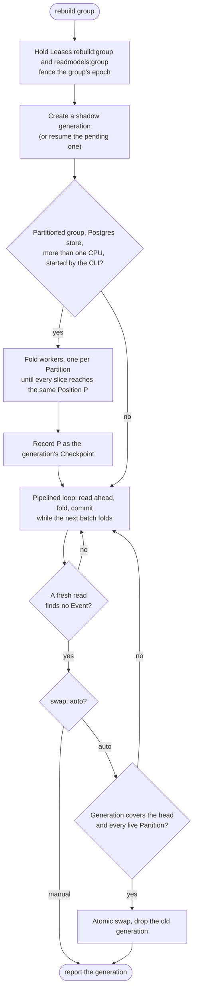
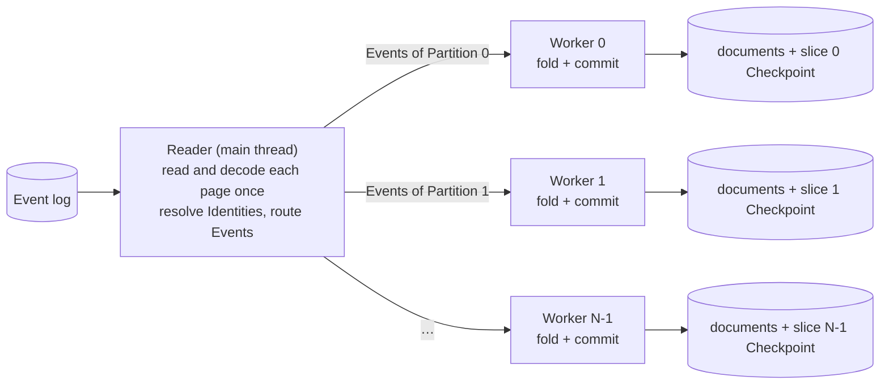

# Readmodel rebuilds

A rebuild recomputes every document of one Readmodel group from the Event log. It writes into a new, unpublished **generation** while the current one keeps serving, then publishes the complete group in one atomic swap. This page follows a rebuild from start to finish, explains each technique it uses and why, gives measured times, and compares it with oblak.

[architecture.md](architecture.md#schema-changes-and-rebuilds) covers when rebuilds are required; this page covers how they run.

## Starting a rebuild

```sh
event-fabric rebuild billing                 # rebuild, catch up, swap, drop the old generation
event-fabric rebuild billing --swap manual   # prepare a generation and report its id; keep serving the old one
event-fabric rebuild --swap billing          # resume a prepared or interrupted generation, catch it up and publish it
```

`application.rebuild(group, { swap, signal })` and `application.swapRebuild(group)` do the same from code. Startup also starts a **required** rebuild, in the background and in dependency order, when a group's stored definition hash changed and no exact migration was declared. Reads of that group then return `ReadmodelRebuildingError` (HTTP 503) until the swap; an explicit rebuild keeps the old generation readable throughout.

Only Readmodel groups are rebuilt. Sagas are never replayed, because replaying them would repeat their effects.

## The whole path



### 1. Ownership

A rebuild holds two Leases: `rebuild:<group>`, so only one rebuild of a group runs at a time across replicas, and the group's own `readmodels:<group>` Lease, its own or one borrowed from the replica that holds it. It then fences the group: the epoch rises, and every write the store accepts must carry the current epoch. A rebuild that loses its Lease cannot commit afterwards; a second rebuild that takes over cannot be overtaken by the first one's late commits.

### 2. A shadow generation

Each generation has its own tables (Postgres) or collections (Mongo), named after group, model and the generation's tag, the first 8 hex characters of its id. For example, `rm_billing_invoices_3f9a1c2e` on Postgres, or `invoices_3f9a1c2e` in the group's database `<database>-billing-readmodels` on Mongo ([Readmodel storage](../README.md#stores-and-adapters)). Generations created before readable names keep hashed names until the group's next rebuild. Live processing keeps writing the active generation; the rebuild writes only the new one, so nothing it does is visible until the swap. Rebuild batches publish no Notifications.

A **reconstruction fingerprint** covering the group's declarations, schemas, declared Event schemas and Upcasters, dependencies and `rebuildVersion` is stored with the generation. A pending generation resumes or swaps only under the same fingerprint, so a deployment with different Reactions cannot finish a half-built generation with mixed logic.

### 3. Reading the log

The rebuild reads only the Event types its Reactions name, in pages of **5,000 Events** (live batches use 100). Every page also reports `through`, the Position up to which the log has been examined, including Events of other types. Progress therefore advances across unrelated history without loading payloads or running Upcasters for it.

- **Visibility.** Readers take only transaction ids below `pg_snapshot_xmin`, so an Event committed later can never appear behind a Position already passed ([ADR-0004](adr/0004-position-is-transaction-id-plus-sequence.md)).
- **Two read strategies.** When the selected types are most of the log, the store scans one page in Position order and keeps the selected Events (about 10 ms per 5,000 billing Events). When they are sparse, it seeks each type through the `(type, Position)` index and skips unrelated history; only Positions are sorted, and only the page's rows are fetched. One query decides which: if the scan reached the head or kept at least half its rows, its result stands.
- **Startup.** The list of Event names in the log comes from a loose index scan over the same index: 0.1 s instead of 159 s over 8.58M Events.

### 4. Folding a batch

Folding runs the group's Reactions over the page, document by document, in Position order.

- **Identities first.** For each model, the Identity of every Event in the page is resolved once, and all documents with Event-only Identities are loaded in one query per model. Query Identities still run against the state at their Event, including changes staged earlier in the batch.
- **Staged reads.** A Reaction that reads its own group sees the stored generation overlaid with the batch's staged changes.
- **Fold budget.** A rebuild folds for up to 2 s per batch (live: 50 ms). If the budget ends mid-page, the batch commits the completed Events and the rest of the page folds next, without reading or decoding it again.
- **Documents folded in place.** Store reads return fresh copies, and a rebuild publishes no "before" document, so the fold changes the documents it owns in place instead of copying them per Reaction. The document of a batch that is still committing is the exception: it is copied before it changes.
- **Frozen Events.** Reactions receive a deeply frozen Event. The Event is frozen in place, not copied.

### 5. Writing a batch

A batch commits its documents and its Checkpoint in one transaction ([ADR-0009](adr/0009-readmodel-stores-atomic-checkpoint-relational-layout.md)). A crash before the commit loses nothing but time; a crash after it resumes after the Checkpoint. The transaction refuses a stale epoch or a changed fingerprint.

On Postgres each model's documents are replaced set-wise: one `DELETE … WHERE _id = ANY($1)` (child rows cascade), then multi-row `INSERT`s per table, parents first, chunked under PostgreSQL's 65,535-parameter limit. Mongo writes one ordered `bulkWrite` per model inside the transaction.

### 6. The pipelined loop

A rebuild never waits for one step before starting the next:

- It reads page N+1 while page N folds.
- It commits batch N while batch N+1 folds. Batch N+1 sees batch N's uncommitted documents, which it treats as read-only: it neither changes nor writes them again. Only one commit is in flight, and commits stay in order.
- A failed commit stops the rebuild before anything later commits; a rerun resumes from the stored Checkpoint.
- A page read ahead may predate Events appended meanwhile, so only a fresh read, after the last commit, can end the loop.

### 7. Fold workers

A group declared with `partitions: N > 1`, on the Postgres Readmodel store, rebuilt through the CLI on a machine with more than one CPU, folds in N worker threads, one per Partition:



- **Ownership.** Each worker owns the documents `fnv1a("model/id") % N` assigns it, the same split live Partitions use ([ADR-0016](adr/0016-consumer-groups-partitioned-by-document-and-saga-instance.md)). Partitioned groups already promise that their Reactions do not read their own group, so workers cannot observe each other.
- **One reader.** The main thread reads and decodes each page once, resolves each Event's Identities and sends the Event only to the workers owning one of its documents. Events with query Identities, or Identities that fail, go to every worker, which resolves them as a Partition does. Every worker receives every page's `through`, and the reader stays at most two pages ahead of the slowest worker.
- **Workers.** Each worker loads the Application from the configuration module the CLI was given, folds its Events with the pipelined loop and commits its documents with its own slice Checkpoint (`<group>@<generation>#<slice>`), under its own lock. Whole-group writes such as fences still exclude them.
- **Handoff.** When the reader finds the end of the log, every slice has committed through the same Position P. P becomes the generation's Checkpoint, and the pipelined loop continues from P to the head and swaps as usual.
- **Resume.** A stopped worker rebuild resumes each slice from its own Checkpoint. The reader starts at the lowest one, and each worker skips what it has already committed. Resuming requires workers and the same `partitions`; anything else is refused instead of folding twice ([Stopping and resuming](#9-stopping-and-resuming)).
- **When workers stay off.** With one CPU (Docker's `--cpus` limit is respected), workers cost more than they fold, so the single loop runs. Memory stores cannot be shared between threads, and Mongo would need every slice to write the group record to stay fenced, so both keep the single loop.

### 8. Catching up and swapping

When a fresh read finds nothing more, an automatic rebuild asks the store to swap. The swap succeeds only if the new generation has passed the head the rebuild saw and the furthest live Partition of the old generation; otherwise the loop reads on (`GenerationBehindError`). The swap makes the generation active for every replica in one transaction; Partition batches in flight against the old generation are refused and fold again against the new one. The old generation's tables are then dropped.

With `--swap manual` the rebuild stops at the head and reports the generation; `rebuild --swap <group>` later catches it up and swaps.

### 9. Stopping and resuming

A rebuild can stop at any moment (`kill -9`, a lost container, an out-of-memory kill, a failed Reaction or commit, `close()`) without harming anything that serves reads, and the next run continues from what was committed. Nothing needs to be stopped gracefully. This holds for the Postgres and Mongo stores; the memory store keeps nothing across processes.

**What survives a stop.** Every committed batch: its documents and its Checkpoint were written in one transaction, so the stored Checkpoint always describes exactly the documents in the generation. A batch whose transaction was open when the process died is rolled back by PostgreSQL (or Mongo) and folds again. At most the batches in flight are lost: per loop, the one committing and the one folding, so up to about 10,000 Events per worker. The active generation, live processing and reads are not touched, since only the pending generation was being written.

**What the stopped process leaves behind.**

- The pending generation, recorded on the group, with its reconstruction fingerprint.
- Its progress: the generation's Checkpoint or, during the fold-worker phase, one slice Checkpoint per worker (`<group>@<generation>#<slice>`) and no generation Checkpoint yet.
- Its `rebuild:<group>` Lease, which stays held until it expires (`leaseDuration`, 30 s by default). Until then, another rebuild of the group fails with `RebuildRunningError` ("A rebuild is already running for this Readmodel group"); retry after it expires.

**How to resume.**

| Rebuild that stopped | Resume with |
| --- | --- |
| Explicit, `rebuild <group>` or `--swap manual` | `event-fabric rebuild --swap <group>` (or `application.swapRebuild(group)`), which continues the pending generation, catches it up and swaps it in. There is no way to resume and stay manual. |
| Required, started by `start()` after a schema change | Nothing: the next start (any replica that runs the group) resumes the pending generation automatically. A failed attempt in a running replica is logged and retried from its Checkpoint. |

`rebuild <group>` refuses to start another rebuild while one is pending ("A pending rebuild exists; swap it before starting another"), so an interrupted rebuild is never silently abandoned.

The resuming run takes the Leases and fences the group again: the epoch rises, so if the earlier process was only paused, not dead, every later commit of it, its workers' slice commits included, is refused with `StaleEpochError`. Only one process ever writes the generation.

**Where it continues.**

| Stopped during | Resume does |
| --- | --- |
| The single loop (no workers, or after the handoff) | Reads from the generation's Checkpoint and continues the pipelined loop. |
| The fold-worker phase | Starts the same number of workers. The reader starts at the lowest slice Checkpoint (from the start of the log if any slice has none yet), and each worker drops Events at or before its own Checkpoint. Once every slice reaches the same Position, the handoff proceeds as usual. |
| The handoff (every slice at P, generation Checkpoint not yet written) | Restarts the workers; the first read from P finds nothing, so the handoff commits P and the single loop continues. |
| The swap | The swap is one transaction: either the old generation is still active and the run resumes as above, or the new one is already active and there is nothing to resume. |
| After the swap, before dropping the old generation | Nothing to resume; the old generation's tables remain. Drop them with `store.dropGeneration(group, id)`, using the generation's id from the store's generation records (`ef_rm_generations` on Postgres, `<prefix>_generations` on Mongo). The tables or collections to drop end in the first 8 hex characters of that id; the live generation is the group record's `active`. |

**When resuming is refused.** A pending generation resumes only under the conditions that built it, so it can never mix two kinds of output:

- **Different Reactions, schemas, Upcasters, dependencies or `rebuildVersion`.** The reconstruction fingerprint no longer matches; the first commit or the swap is rejected.
- **A worker rebuild resumed from code without `configModule`, or with `partitions: 1`.** Refused with "The pending rebuild of `<group>` folds in N worker threads; resume it through the CLI with partitions: N". An Application created in code does not know its configuration module, so a required rebuild there cannot resume a worker rebuild either; start that replica with `event-fabric run` or resume the rebuild with `event-fabric rebuild --swap <group>`.
- **A worker rebuild resumed with a different `partitions > 1`.** Refused with "This rebuild runs in N slices; discard the pending generation to rebuild with M".

A worker rebuild resumes with workers even on one CPU: its slices must finish where they started. The CPU check only decides whether a fresh rebuild starts workers.

To give up on a pending generation instead, drop it with `store.dropGeneration(group, await store.pendingGeneration(group))`, then start a new rebuild; the active generation stays available. A dropped worker rebuild leaves its small slice records behind; they name the dropped generation and are never read again.

**Measured.** A 4-CPU billing rebuild killed with `docker kill` after 80 s left all four slices at sequence 5,020,000 of 8,579,522 and no generation Checkpoint. After its Leases expired, `rebuild --swap billing` resumed with four workers, reached the head in 91 s (the uninterrupted rebuild takes 166 s), handed over, swapped, and every table hashed identically to the previous active generation.

### 10. What rebuilds do not do

- **No targeted rebuilds.** There is no rebuild by document, model, Position range or Aggregate. Replaying a range onto live documents would apply increments twice and miss deletions.
- **Cross-group reads are current, not historical.** A Reaction reading another group during a rebuild sees that group's current documents, so a rebuild can differ from the original live run. Record values a Reaction needs later in the Events themselves.
- **Operator skips are ignored.** A rebuild retries every Event, including ones skipped live.

## Measured performance

8,579,522 Events of the billing example (`billing` group, 4 Partitions: 1.17M invoices with 1.81M payment rows, 0.82M customers), on a 12 GB copy of its database. Hardware: an Apple M3 Max laptop (14 cores, 36 GB) running Docker through OrbStack; PostgreSQL 18.6 with default settings in a container limited to 4 CPUs and 4 GiB. Times include CLI startup; the laptop was also in use, so single runs vary by about 10%. Every rebuild produced Readmodels hashing identically to the live ones.

| Change | Rebuild CPUs | Full rebuild |
| --- | ---: | ---: |
| Before set-wise writes | 1 | 1,981 s (33 min) |
| Set-wise writes | 1 | 1,144 s |
| Larger pages, no Event copies, fast name scan | 1 | 467 s |
| Pipelined loop | 1 | 319 s |
| Fold workers and the faster page read | 4 | 166 s |
| Same build, workers off on 1 CPU | 1 | 328 s |
| Same build | 2 | 199 s |

On one CPU the workers would compete with the reader and the main thread (370 s when forced on), so a rebuild with fewer than two available CPUs keeps the single loop. With 4 CPUs the rebuild container is no longer the limit: about 60% busy, while PostgreSQL's inserts and WAL writes and the single page reader take the time. A larger `max_wal_size` and more PostgreSQL CPUs are the next levers; more workers than Partitions are not possible, because workers follow `partitions`.

## Compared with oblak

oblak's denormalizer (`cqrs-eventdenormalizer`) applied Events delivered by the broker to Mongo documents. The left column summarizes what an inspection of it recorded ([comparison](comparison-with-oblak.md)).

| | oblak | EventFabric |
| --- | --- | --- |
| Scope | One model, a Position range (`fromPosition`/`toPosition`) or one Aggregate; Tasks also recomputed single documents by hand | Always a whole Readmodel group |
| Destination | Overwrites the live collections in place | A shadow generation, published by one atomic swap |
| Reads during a rebuild | See partly rebuilt documents | See the old generation (explicit rebuild) or get 503 (required rebuild) until the swap |
| Progress | A per-document guard `_oblak: { event: { id, position } }` written into each document | A Checkpoint per generation (or per slice) committed in the same transaction as the documents |
| Writes | One `bulkWrite` of whole-document upserts per batch, no transactions | One transaction per batch: set-wise deletes and multi-row inserts (Postgres) or a `bulkWrite` (Mongo replica set) |
| Interrupted rebuild | Partly rewritten live collections | Resumes from the Checkpoint; nothing visible changed |
| Concurrent writers | No sink-checked epoch: a deposed consumer's late write could land | Leases and epochs: a stale writer's commit is refused |
| Code changes | Nothing tied progress to the code that produced it | A reconstruction fingerprint refuses resuming or swapping under different Reactions |
| Parallelism | Not recorded | One reader and a fold worker per Partition, on Postgres |
| Notifications | Denormalizer Notifications carried operation, id and payload | None while rebuilding; live Notifications resume after the swap |

What EventFabric gives up: targeted repairs of a few documents. Whole-group rebuilds are short enough for real logs that targeted repairs were left out: the billing example's 8.58M Events rebuild in under three minutes on four CPUs.

## Sources

- Decisions: [ADR-0009](adr/0009-readmodel-stores-atomic-checkpoint-relational-layout.md) (atomic Checkpoint), [ADR-0016](adr/0016-consumer-groups-partitioned-by-document-and-saga-instance.md) (Partitions by document).
